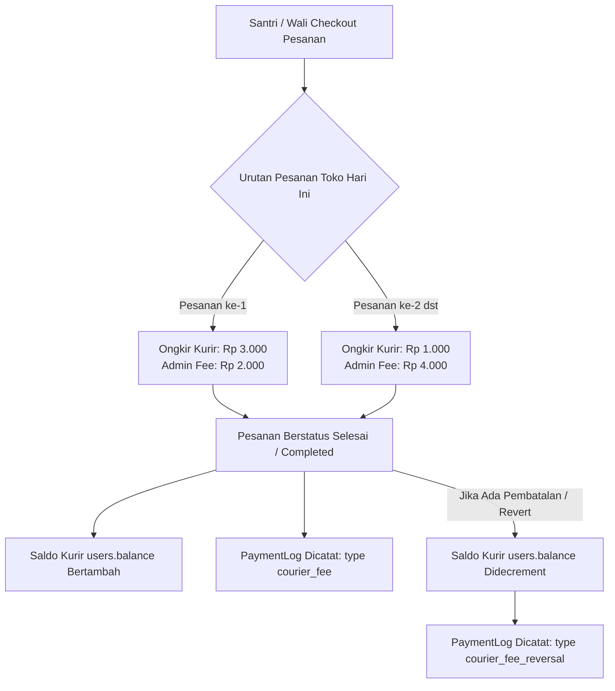

# Laporan Audit Keuangan, Sistem Gaji Kurir, & Analisis Bisnis
**Aplikasi**: Higo Pondok (Pesantren Al Mannan)  
**Lokasi Operasional**: Tulungagung, Jawa Timur, Indonesia  
**Tanggal Audit**: 15 Oktober 2026  
**Status Audit**: Lengkap & Terverifikasi Langsung dari Basis Kode & Database

---

## 1. Ringkasan Eksekutif (Executive Summary)

Audit ini dilakukan untuk mengevaluasi secara menyeluruh:
1. **Logika dan alur sistem penggajian kurir** di dalam sistem Higo Pondok.
2. **Kesehatan dan integritas buku keuangan serta jurnal transaksi** (pembukuan kas, mutasi saldo, pencairan dana).
3. **Kesesuaian model bisnis dan tarif operasional** dengan kondisi perekonomian riil di wilayah **Kabupaten Tulungagung, Jawa Timur**.

### Temuan Kunci:
* **Distribusi Dana Pesanan**: Sistem saat ini telah membagi pendapatan pesanan secara terpisah antara:
  * **Kantin/Toko**: Menerima Harga Pokok Penjualan (HPP) + Laba Bersih.
  * **Kas Pengelola Aplikasi (Admin)**: Menerima Biaya Layanan (*Admin Fee*).
  * **Kurir**: Menerima Ongkos Kirim (*Delivery Fee*).
* **Isu Kritis Gaji Kurir**: Terdapat aturan pengurangan ongkir pada pesanan ke-2 dan seterusnya dari toko yang sama dalam 1 hari (*user ranked fee*), di mana ongkir kurir dipotong Rp 2.000 dan dialihkan ke kas admin. Akibatnya, kurir hanya menerima **Rp 1.000 per pesanan tambahan**. Angka ini dinilai **kurang manusiawi dan berisiko tinggi** untuk operasional lapangan di Tulungagung.
* **Ketiadaan Buku Kas & Payout Kurir**: Toko/Kantin telah memiliki buku mutasi saldo (`CanteenBalanceLedger`) dan fitur pencairan dana (`CanteenWithdrawal`). Sebaliknya, **kurir belum memiliki buku kas saldo khusus** maupun **fitur pencairan gaji/payout di aplikasi**, sehingga saldo kurir terus membengkak di database tanpa catatan penyelesaian kas fisik.

---

## 2. Alur & Logika Sistem Gaji Kurir Saat Ini

### A. Diagram Alur Transaksi & Gaji Kurir



### B. Konfigurasi Tarif Aktif (`backend/config/pricing.php`)

| Parameter | Nilai Saat Ini | Keterangan |
| :--- | :--- | :--- |
| `base_delivery_fee` | Rp 3.000 | Tarif dasar ongkir kurir per pesanan |
| `base_admin_fee` | Rp 2.000 | Tarif dasar biaya layanan admin pondok |
| `extra_delivery_per_5_items` | Rp 2.000 | Tambahan untuk kurir jika pesanan > 5 barang |
| `extra_admin_per_5_items` | Rp 3.000 | Tambahan untuk admin jika pesanan > 5 barang |
| `user_threshold_limit` | 1 pesanan | Batas pesanan yang menerima ongkir kurir utuh |
| `user_threshold_courier_cut` | Rp 2.000 | Nilai potongan ongkir kurir yang dialihkan ke admin |

### C. Logika Eksekusi di Controller
1. **Perhitungan saat Checkout** (`app/Domains/Canteen/Controllers/OrderController.php`):
   ```php
   $userIndex = Order::getUserDailyIndex($user->id, $canteen->id, $today);
   $fees = Order::calculateUserRankedFees($totalQuantity, $userIndex);
   // Jika $userIndex > 1, delivery_fee menjadi Rp 1.000, admin_fee menjadi Rp 4.000
   ```
2. **Kredit Saldo saat Pesanan Selesai**:
   ```php
   $courier->increment('balance', $courierFee);
   PaymentLog::create([
       'user_id'     => $courier->id,
       'order_id'    => $order->id,
       'amount'      => $courierFee,
       'type'        => 'courier_fee',
       'description' => "Penerimaan ongkir pesanan #{$order->id}"
   ]);
   ```
3. **Pembalikan Saldo (*Revert/Cancel*)**:
   ```php
   $courier->decrement('balance', min((float)$courier->balance, $courierFee));
   PaymentLog::create([
       'user_id'     => $courier->id,
       'order_id'    => $order->id,
       'amount'      => $courierFee,
       'type'        => 'courier_fee_reversal',
       'description' => "Pembalikan ongkir kurir pesanan #{$order->id} karena dibatalkan"
   ]);
   ```

---

## 3. Temuan Audit: Buku Keuangan & Jurnal

### A. Perbandingan Buku Kas Kantin vs Kurir

```
┌──────────────────────────────────────┬──────────────────────────────────────┐
│        BUKU KAS KANTIN / TOKO        │           BUKU KAS KURIR             │
├──────────────────────────────────────┼──────────────────────────────────────┤
│ ✅ Tabel CanteenBalanceLedger ada     │ ❌ Belum ada CourierBalanceLedger    │
│ ✅ Ada saldo sebelum (balance_before)│ ❌ Tidak mencatat balance_before     │
│ ✅ Ada saldo sesudah (balance_after) │ ❌ Tidak mencatat balance_after      │
│ ✅ Ada fitur penarikan (Withdrawal)  │ ❌ Belum ada fitur pencairan gaji    │
│ ✅ Terintegrasi audit trail lengkap  │ ⚠️ Hanya mengandalkan PaymentLog     │
└──────────────────────────────────────┴──────────────────────────────────────┘
```

#### Kondisi Nyata Database Saat Ini:
* Saldo riil kurir saat ini di database:
  * **Kurir Pak Faris**: `Rp 32.000` (terakumulasi dari pesanan selesai).
  * **Kurir Pak Ega**: `Rp 49.000`.
* **Kelemahan Operasional**: Ketika pengelola pondok membayarkan uang tunai gaji kurir pada sore atau malam hari, admin **tidak memiliki tombol pencairan dana kurir** di sistem. Akibatnya:
  1. Saldo kurir di aplikasi tetap bernilai puluhan ribu rupiah dan tidak pernah kembali ke nol.
  2. Terjadi ketidaksinkronan (*discrepancy*) antara uang kas di laci admin dan data di sistem.
  3. Rentan terjadi komplain atau dobel bayar karena tidak ada bukti tanda terima pencairan gaji kurir.

### B. Desain Jurnal Akuntansi Berpasangan (Double-Entry Bookkeeping)

Sistem saat ini baru mencatat *single-entry activity log*. Untuk tata kelola keuangan pesantren yang akuntabel, pencatatan transaksi harus mengikuti kaidah debit-kredit berikut:

#### 1. Jurnal Pembayaran Pesanan Masuk (Uang Diterima dari Wali Santri)
*Contoh Transaksi: Total Belanja Rp 15.000 (Produk Rp 10.000 [HPP Rp 8.000 + Laba Toko Rp 2.000], Ongkir Kurir Rp 3.000, Admin Pondok Rp 2.000)*
```text
(D) Kas Masuk / Bank QRIS Pondok ............. Rp 15.000
    (K) Hutang Saldo Kantin (Titipan Dana) ................ Rp 10.000
    (K) Hutang Upah Ongkir Kurir .......................... Rp  3.000
    (K) Pendapatan Jasa Layanan Aplikasi .................. Rp  2.000
```

#### 2. Jurnal Pembayaran Gaji / Pencairan Ongkir Kurir
*Saat admin menyerahkan uang tunai/transfer ke Kurir Pak Faris:*
```text
(D) Hutang Upah Ongkir Kurir ................. Rp  3.000
    (K) Kas Operasional Pondok ............................ Rp  3.000
```
*(Saldo kurir di aplikasi berkurang menjadi Rp 0, kas fisik laci terpotong secara sah).*

#### 3. Jurnal Pencairan Dana Penjualan Kantin
*Saat Kantin mencairkan laba penjualannya:*
```text
(D) Hutang Saldo Kantin (Titipan Dana) ....... Rp 10.000
    (K) Kas Operasional / Rekening Bank ................... Rp 10.000
```

---

## 4. Kajian Bisnis & Manajemen Keuangan Wilayah Tulungagung

### A. Konteks Perekonomian & Geografis Tulungagung
1. **Upah Minimum Kabupaten (UMK) Tulungagung**:
   * UMK Tulungagung berkisar antara **Rp 2.300.000 – Rp 2.450.000 per bulan**.
   * Jika dibagi 25 hari kerja, standar penghasilan harian tenaga kerja di Tulungagung adalah **Rp 90.000 – Rp 98.000 per hari** (atau sekitar **Rp 11.000 – Rp 13.000 per jam**).
2. **Karakteristik Operasional Lingkungan Pesantren**:
   * Jarak tempuh rata-rata pengantaran makanan di area pondok dan sekitarnya (seperti Kauman, Kedungwaru, Boyolangu, Ngunut) adalah 1 s.d. 3 kilometer.
   * Biaya bahan bakar Pertalite: Rp 10.000/liter (efektif untuk 35–45 km atau ~15–20 kali perjalanan).
   * Tenaga fisik yang dibutuhkan: Kurir harus mengambil makanan di toko, berkendara, memarkir kendaraan, memasuki gerbang asrama, mencari santri/kamar, serta mengunggah bukti foto serah terima.

### B. Evaluasi Risiko Skema "Potongan Rp 2.000 pada Pesanan ke-2+"

> [!CAUTION]
> **Risiko Operasional & Human Capital**:
> Menetapkan upah kurir sebesar **Rp 1.000** untuk pesanan ke-2 dan seterusnya memiliki kelemahan bisnis serius:
> 1. **Demosi Motivasi Kurir**: Biaya parkir motor umum saja Rp 2.000. Menerima upah Rp 1.000 per paket dapat dianggap merugikan tenaga kerja, sehingga kurir berisiko menolak pesanan rombongan atau bekerja asal-asalan.
> 2. **Ketimpangan Margin**: Pada pesanan ke-2+, Admin pondok mengambil **Rp 4.000**, sedangkan kurir yang menanggung risiko fisik dan bahan bakar hanya mendapatkan **Rp 1.000** (Rasio 80% Admin : 20% Kurir). Ini bertentangan dengan prinsip keadilan ekonomi pesantren.

### C. Usulan Skema Tarif Baru yang Adil & Berkelanjutan

Untuk menjaga keseimbangan antara kepuasan wali santri, motivasi kurir, dan kas operasional pondok:

| Skenario | Skema Lama (Saat Ini) | Rekomendasi Skema Baru (Adil) | Dampak Bisnis |
| :--- | :--- | :--- | :--- |
| **Pesanan ke-1** | Kurir: Rp 3.000<br>Admin: Rp 2.000 | **Kurir: Rp 3.000**<br>**Admin: Rp 2.000** | Standar dasar tetap terjaga. |
| **Pesanan ke-2 dst** | Kurir: Rp 1.000 ⚠️<br>Admin: Rp 4.000 | **Kurir: Rp 2.000** ✅<br>**Admin: Rp 3.000** ✅ | Kurir tetap semangat mengantar borongan; Admin tetap untung Rp 3.000. |

#### Simulasi Pendapatan Harian Kurir (Mengantar 35 Pesanan / Hari):
* **Rute Tunggal (15 pesanan)**: 15 × Rp 3.000 = Rp 45.000.
* **Rute Rombongan Tambahan (20 pesanan)**: 20 × Rp 2.000 = Rp 40.000.
* **Total Penghasilan Kurir**: **Rp 85.000 / hari**.
* **Potongan Bensin (1,5 liter)**: -Rp 15.000.
* **Penghasilan Bersih Kurir**: **Rp 70.000 / hari** (sangat layak dan mendekati UMK harian Tulungagung).
* **Total Pemasukan Kas Admin Pondok**: (15 × Rp 2.000) + (20 × Rp 3.000) = **Rp 90.000 / hari** (bersih masuk ke kas pemeliharaan sistem pondok).

---

## 5. Rencana Aksi Perbaikan Sistem (Roadmap)

```
┌─────────────────────────────────────────────────────────────────────────────┐
│                       ROADMAP PENYEMPURNAAN SISTEM                          │
└─────────────────────────────────────────────────────────────────────────────┘
  Tahap 1: Pembukuan & Fitur Payout Kurir
   ├── Buat model & migrasi `CourierBalanceLedger` (Buku Kas Kurir)
   ├── Buat model & migrasi `CourierWithdrawal` (Pencairan Gaji Kurir)
   └── Tambahkan tombol "Pencairan Gaji Kurir" di halaman admin mobile & web
  
  Tahap 2: Optimalisasi Algoritma Tarif di config/pricing.php
   ├── Ubah `user_rank_2_courier_cut` menjadi Rp 1.000 (Kurir dapat Rp 2.000)
   └── Perbarui kalkulasi `Order::calculateUserRankedFees()`
  
  Tahap 3: Modul Rekonsiliasi Kas Harian (Daily Cash Close-out)
   ├── Laporan tutup kas otomatis setiap pukul 21:00 WIB
   └── Cetak/Ekspor rekapitulasi kas harian untuk pengurus pondok
```

---

## 6. Kesimpulan

Secara keseluruhan, arsitektur dasar sistem Higo Pondok sudah sangat solid dan menggunakan pola Domain-Driven Design yang rapi. Namun, untuk menjamin kesinambungan operasional jangka panjang di Tulungagung:
1. **Fitur Pencairan Gaji Kurir (`CourierWithdrawal`)** harus segera diaktifkan agar saldo kurir di aplikasi tidak menumpuk tanpa rekonsiliasi uang fisik.
2. **Besaran upah pesanan rombongan kurir** perlu dinaikkan menjadi minimal **Rp 2.000** agar kurir tidak nombok biaya operasional dan hubungan kemitraan dengan pondok tetap harmonis dan berkah.
