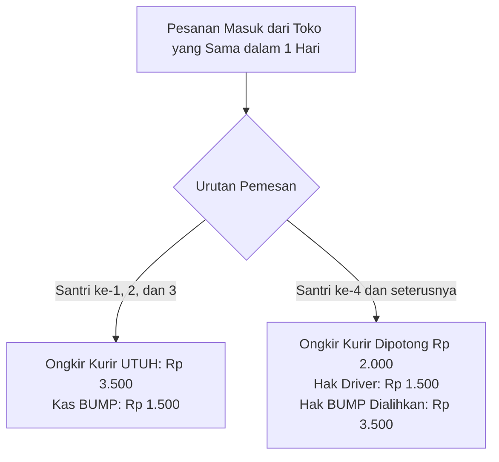

# Dokumen Peraturan Audit & Manual Operasional Asli (Lama)
**Unit Usaha**: Hidayah Go (Jastip Makanan, Minuman Kafe, & Obat-obatan)  
**Naungan Lembaga**: BUMP Al Hidayah – PPTQ Al Mannan, Tulungagung, Jawa Timur  
**Sumber Rujukan Resmi**: `Manual_Operasional_Hidayah_Go_SP_1-4.md` (Versi Juli 2026)  
**Tujuan Dokumen**: Standar audit kepatuhan (*compliance audit*), pembukuan kas, tarif dasar, dan etika kerja seluruh pihak.

---

## 1. Profil Layanan & Jadwal Operasional Resmi

* **Nama Unit**: Hidayah Go
* **Badan Pengelola**: BUMP Al Hidayah – PPTQ Al Mannan
* **Sasaran Layanan**: Seluruh santri dan santriwati PPTQ Al Mannan
* **Wilayah Layanan**: Area Kauman dan Area Kota Tulungagung
* **Jadwal Waktu Kerja Harian**:
  * **09.00 – 17.00 WIB**: Layanan pemesanan dibuka, pengecekan detail pesanan, dan verifikasi bukti pembayaran.
  * **Pukul 17.00 WIB TEPAT**: Batas akhir pembayaran (*cut-off time*). Pesanan yang belum lunas otomatis dibatalkan (*auto-cancel*).
  * **17.00 – 18.00 WIB**: Admin merekap pesanan dan menyusun *manifest* rute belanja driver.
  * **18.30 – 20.45 WIB**: Driver melakukan pembelian fisik di warung/merchant dan perjalanan menuju pondok.
  * **Maksimal 20.45 WIB**: Driver **wajib sudah tiba di pondok** dan menyerahkan seluruh belanjaan beserta nota fisik ke pos admin/kantin.
  * **Pukul 21.00 WIB**: Santri mengambil pesanan di kantin asrama secara tertib.

---

## 2. Peraturan Finansial, Tarif Jasa, & Pembagian Hasil (*Profit Sharing*)

### A. Tarif Dasar Normal (Pesanan 1–5 Item)
* Tarif jasa dihitung **per pemesan per toko/merchant** (bukan per jenis makanan satuan).
* **Total Tarif Jasa Normal**: **Rp 5.000**
  * **Hak Driver / Kurir**: **Rp 3.500** (70%)
  * **Hak Kas Admin BUMP**: **Rp 1.500** (30%)

### B. Aturan Tambahan Kuantitas (> 5 Item dari Toko yang Sama)
Jika 1 santri memesan lebih dari 5 item pada merchant yang sama, setiap kelipatan 5 item dikenakan biaya tambahan:
* **Tambahan per kelipatan 5**: **+Rp 2.300**
  * **Tambahan Hak Driver**: **+Rp 2.000**
  * **Tambahan Hak BUMP**: **+Rp 300**

#### Tabel Skema Tarif Kuantitas Resmi:
| Jumlah Item per Toko | Total Biaya Jasa | Hak Driver | Hak Admin BUMP |
| :--- | :--- | :--- | :--- |
| **1 – 5 pcs (Normal)** | **Rp 5.000** | **Rp 3.500** | **Rp 1.500** |
| **6 – 10 pcs (+1 Kelipatan)** | **Rp 7.300** | **Rp 5.500** (+Rp 2.000) | **Rp 1.800** (+Rp 300) |
| **11 – 15 pcs (+2 Kelipatan)**| **Rp 9.600** | **Rp 7.500** (+Rp 4.000) | **Rp 2.100** (+Rp 600) |
| **16 – 20 pcs (+3 Kelipatan)**| **Rp 11.900**| **Rp 9.500** (+Rp 6.000) | **Rp 2.400** (+Rp 900) |
| **Kelipatan berikutnya** | **+Rp 2.300** | **+Rp 2.000** | **+Rp 300** |

---

### C. Aturan Efisiensi Pengantaran Gabungan (*Batching Order Cut*)

Aturan ini berlaku jika dalam 1 hari kalender terdapat beberapa santri berbeda memesan pada toko/merchant yang sama:



* **Santri ke-1, ke-2, dan ke-3**: Driver menerima ongkir utuh sebesar **Rp 3.500** per santri (BUMP menerima Rp 1.500).
* **Santri ke-4 dan seterusnya**: Ongkir kurir dipotong sebesar **Rp 2.000** dialihkan ke kas BUMP:
  * **Hak Driver**: Menjadi **Rp 1.500**.
  * **Hak BUMP**: Menjadi **Rp 3.500**.

---

## 3. Prosedur Pembayaran, Kas Kantin, & Audit Nota

1. **Jalur Pembayaran**:
   * Transfer rekening bank resmi Hidayah Go.
   * Virtual Account (VA).
   * Tunai via Kantin Asrama.
2. **Aturan Pembayaran Melalui Kantin**:
   * Santri menyerahkan uang tunai ke petugas kantin asrama.
   * Petugas kantin mencatat nama santri, asrama, merchant, dan nominal.
   * Petugas kantin mengubah/melaporkan status pesanan menjadi **Lunas**.
   * **Penyetoran Kas**: Petugas kantin asrama **wajib menyetorkan fisik uang transaksi harian kepada Bendahara BUMP** setiap hari.
3. **Kewajiban Audit Nota Pembelian**:
   * Driver **wajib meminta dan menyerahkan nota asli** dari setiap outlet/merchant.
   * Nota menjadi bukti audit sah untuk memastikan tidak ada mark-up harga.
   * Jika ada selisih antara estimasi harga di aplikasi dan nota riil toko, admin wajib mengonfirmasi penyesuaian kepada pemesan.

---

## 4. Standar Operasional Prosedur (SOP) Tiap Pihak

### A. SOP Santri / Pemesan
* Memesan hanya melalui HP asrama resmi (dilarang memesan langsung ke driver).
* Menuliskan detail pesanan, jumlah, level pedas, dan catatan khusus secara jelas.
* Menyelesaikan pembayaran lunas sebelum pukul 17.00 WIB.
* Mengambil pesanan di kantin asrama pukul 21.00 WIB dengan tertib dan membawa bukti identitas/kamar.
* Wajib memeriksa makanan di tempat; komplain tidak berlaku jika barang sudah dibawa ke kamar berjam-jam kemudian.

### B. SOP Admin Pemegang HP
* Membuka layanan pukul 09.00 WIB dan menutup pukul 17.00 WIB.
* Memverifikasi pembayaran dan memberi status Lunas sebelum jam 17.00 WIB.
* Membatalkan pesanan yang belum lunas setelah jam cut-off.
* Mengelompokkan pesanan berdasarkan merchant dan membuat *manifest* belanja untuk driver.
* Menerima pesanan dan nota dari driver pada pukul 20.45 WIB, mencocokkan jumlah dan item belanjaan.
* Memisahkan paket pesanan per santri/kamar dan menyerahkannya ke pos kantin.
* Menyusun buku rekap harian untuk Bendahara BUMP.

### C. SOP Driver / Ojek
* Menerima daftar manifest dari admin dan membelanjakan sesuai rincian.
* Mengonfirmasi jika menu habis, harga berubah, outlet tutup, atau antrean panjang.
* Meminta nota pembelian fisik untuk setiap transaksi belanja.
* Menjaga keamanan makanan/minuman agar tidak rusak, tumpah, atau kotor.
* Tiba di pondok maksimal pukul 20.45 WIB.
* **Etika Pesantren**:
  * Berpakaian sopan dan rapi.
  * **Dilarang merokok** di seluruh lingkungan pondok.
  * **Dilarang menyerahkan pesanan langsung ke santri** (wajib lewat admin/kantin).
  * Menjaga adab dan tidak berinteraksi berlebihan dengan santri/santriwati.

---

## 5. Sistem Audit Disiplin: Surat Peringatan (SP 1 – 4)

Manual operasional memberlakukan matriks audit kedisiplinan dan sanksi berjenjang yang ketat:

### A. SP 1–4 untuk Driver / Ojek
| Tingkat | Kategori Pelanggaran | Tindak Lanjut & Sanksi |
| :--- | :--- | :--- |
| **SP 1** *(Teguran Tertulis)* | Terlambat tanpa alasan jelas; lambat merespons admin; tidak membawa tas/wadah layak; lupa nota (bisa dilengkapi); pakaian kurang rapi. | Teguran tertulis; pembinaan oleh admin/BUMP; dicatat di buku evaluasi. |
| **SP 2** *(Peringatan Keras)* | Mengulangi SP 1; tidak meminta nota; tidak konfirmasi harga berubah/habis; pesanan tertukar akibat lalai; **merokok di area pondok**; komunikasi tidak sopan. | Peringatan keras tertulis; **pengurangan jadwal tugas sementara**; surat komitmen perbaikan. |
| **SP 3** *(Sanksi Berat / Suspensi)* | **Menyerahkan pesanan langsung ke santri**; mengubah pesanan tanpa izin; uang/nota hilang berulang; makanan tumpah/rusak parah; berkata kasar. | **Skorsing/suspensi tugas sementara**; **wajib mengganti ganti rugi materiil pesanan**. |
| **SP 4** *(Pemutusan Kerja Sama)* | **Mencuri/menggelapkan** uang, makanan, atau obat; manipulasi harga/nota palsu; pelecehan/kekerasan; membawa barang terlarang ke pondok; mencemarkan nama baik PPTQ Al Mannan. | **Pemberhentian permanen sebagai driver**; pencabutan seluruh akses; penyelesaian hukum/ganti rugi. |

---

### B. SP 1–4 untuk Admin Pemegang HP
| Tingkat | Kategori Pelanggaran | Tindak Lanjut & Sanksi |
| :--- | :--- | :--- |
| **SP 1** *(Teguran Tertulis)* | Terlambat buka/tutup order; kurang teliti mengecek pesanan; lambat membalas chat layanan; rekap harian kurang rapi. | Teguran tertulis; evaluasi internal admin. |
| **SP 2** *(Peringatan Keras)* | **Memproses pesanan belum lunas tanpa izin pengurus**; lalai menyimpan nota/bukti transfer; salah hitung timbul selisih kas; mengabaikan komplain santri. | Peringatan keras; wajib menyelesaikan selisih data kas; didampingi admin lain. |
| **SP 3** *(Sanksi Berat / Suspensi)* | Mengubah data transaksi tanpa izin; sengaja menahan nota; mengabaikan komplain berulang; menghilangkan uang pesanan santri. | **Skorsing sebagai admin**; wajib mengganti kerugian selisih kas; evaluasi pengurus. |
| **SP 4** *(Pemberhentian Admin)* | **Penggelapan dana transaksi jastip untuk keperluan pribadi**; manipulasi laporan keuangan rekap; kerja sama curang dengan pihak luar. | **Diberhentikan dari penugasan admin**; audit investigasi; sanksi disiplin pondok. |

---

### C. SP 1–4 untuk Santri / Pemesan
| Tingkat | Kategori Pelanggaran | Tindak Lanjut & Sanksi |
| :--- | :--- | :--- |
| **SP 1** *(Teguran Tertulis)* | Format pesanan tidak lengkap berulang kali; terlambat mengambil pesanan di kantin; tidak tertib saat antre; ubah pesanan berkali-kali. | Teguran tertulis dari pengurus; pembinaan kamar. |
| **SP 2** *(Peringatan Keras)* | Belum bayar tapi memaksa diproses; membatalkan saat driver sudah beli; mengambil pesanan santri lain tanpa izin; membuat keributan di kantin. | Peringatan keras; **wajib mengganti biaya pesanan yang dibatalkan**; pembatasan akun. |
| **SP 3** *(Skorsing Layanan)* | Memesan langsung ke driver di luar jalur resmi; tidak mau membayar kerugian; mengulangi pelanggaran SP 2; tidak sopan ke admin/kantin. | **Pemblokiran hak pesan Hidayah Go sementara (1–4 minggu)**; pemanggilan wali/asrama. |
| **SP 4** *(Larangan Permanen)* | Memesan barang terlarang pesantren; mencuri pesanan santri lain; memalsukan bukti transfer bank. | **Larangan permanen menggunakan Hidayah Go**; diserahkan ke bagian Keamanan Pondok. |

---

## 6. Format Rekapitulasi Kas Harian Admin BUMP

Sesuai **Bagian XIV**, formulir audit harian yang wajib dilaporkan kepada Bendahara BUMP meliputi:

```text
=====================================================
         REKAPITULASI HARIAN HIDAYAH GO - BUMP
=====================================================
Tanggal                  : [ YYYY-MM-DD ]
Nama Admin Bertugas      : [ .................... ]

1. ARUS PESANAN
   - Pesanan Area Kauman : ..... pesanan
   - Pesanan Area Kota   : ..... pesanan
   - Pesanan Obat-obatan : ..... pesanan
   -------------------------------------------------
   TOTAL PESANAN         : ..... pesanan

2. KEUANGAN & PEMBAGIAN HASIL (PROFIT SHARING)
   - Total Belanja Makanan (Nota Riil) : Rp .............
   - Total Tarif Jasa Diterima        : Rp .............
   - Hak Driver (Wajib Dibayarkan)    : Rp .............
   - Hak Kas Admin BUMP (Laba Bersih) : Rp .............
   -------------------------------------------------
   TOTAL OMSET DITERIMA               : Rp .............

3. SALURAN PENERIMAAN KAS
   - Transfer Bank / QRIS             : Rp .............
   - Virtual Account (VA)             : Rp .............
   - Kas Tunai Kantin Asrama          : Rp .............
   -------------------------------------------------
   TOTAL KAS TERKUMPUL                : Rp .............

4. AUDIT FISIK NOTA
   - Jumlah Nota Pembelian Toko Masuk : ..... lembar
   - Status Selisih Kas               : Rp 0 (Klop) / Selisih Rp .....

Catatan Kendala & Evaluasi:
.....................................................
Petugas Admin,                    Bendahara BUMP,


(...................)             (...................)
=====================================================
```

---

## 7. Matriks Perbandingan: Aturan Asli (`audit_lama.md`) vs Sistem Aktif (`audit.md`)

| Indikator | Aturan Asli Manual BUMP (`audit_lama.md`) | Kondisi Sistem Aktif (`audit.md`) | Catatan Auditor |
| :--- | :--- | :--- | :--- |
| **Porsi Tarif Dasar** | Driver Rp 3.500 (70%)<br>BUMP Rp 1.500 (30%) | Driver Rp 3.000 (60%)<br>Admin Rp 2.000 (40%) | Hak driver berkurang Rp 500 pada sistem baru. |
| **Batas Rombongan (*Threshold*)** | **3 santri pertama ongkir utuh** (baru santri ke-4 dipotong). | **Hanya 1 santri pertama ongkir utuh** (mulai santri ke-2 langsung dipotong). | Sistem aktif saat ini memangkas ongkir kurir terlalu dini. |
| **Upah Kurir Pesanan Rombongan** | **Rp 1.500** per santri tambahan | **Rp 1.000** per santri tambahan | Kurir menerima lebih rendah dari manual resmi. |
| **Tambahan per 5 Item** | Driver +Rp 2.000, Admin +Rp 300 (Total +Rp 2.300) | Driver +Rp 2.000, Admin +Rp 3.000 (Total +Rp 5.000) | Beban santri di sistem aktif lebih mahal Rp 2.700. |
| **Batas Waktu Tiba** | Maksimal pukul 20.45 WIB | Belum ada validasi jam tiba otomatis | Perlu penegasan jadwal di sistem. |
| **Sistem Disiplin SP 1-4** | Diatur lengkap dalam SK Manual BUMP | Belum ada fitur pencatatan SP digital di dashboard admin | Perlu digitalisasi log peringatan. |
